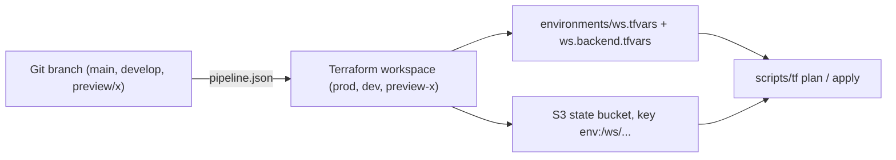

# Terraform AWS Template

Starting point for an AWS project with Terraform or OpenTofu. You create your own repository from it, replace the placeholders, and add your resources. A private example bucket shows how a resource, variables, and tags fit together.

The Git branch is the environment. `main` is `prod`; more stages and short-lived preview environments are one `scripts/setup` run away. The optional GitHub pipeline runs plan and apply from a pull request comment, with OIDC instead of access keys and a lock per environment.



- New to Terraform? Start with [Prerequisites](#prerequisites) and [Quick start](#quick-start); the [Glossary](#glossary) explains the terms.
- Know Terraform? [How it works](#how-it-works) explains the design and its limits; [docs/pipeline.md](docs/pipeline.md) has the pipeline and the IAM policies.

## Prerequisites

- **OpenTofu or Terraform `>= 1.10`.** The template ships with OpenTofu: `brew install opentofu`. For Terraform: `brew install hashicorp/tap/terraform`. `scripts/setup` switches between them.
- **jq.** `scripts/tf` and `scripts/setup` read `pipeline.json` with it: `brew install jq` on macOS, `sudo apt-get install jq` on Debian or Ubuntu. Without it the scripts stop and print this hint.
- **AWS CLI with credentials for the target account**, for example `aws sso login` or an `AWS_PROFILE`. The scripts do not manage credentials.
- **git.** `scripts/tf` reads the checked-out branch.

Optional for contributing: `pre-commit` and the linters, see [docs/tooling.md](docs/tooling.md).

## Quick start

Ten minutes from an empty repository to the first plan. Every step is explained in more depth further down.

### 1. Create your repository

Click **Use this template** on GitHub, or clone this repository. Check out `main`.

### 2. Run the setup

```bash
scripts/setup
```

The script asks four things with arrow-key menus: the tool (it shows which one is installed), the environments (keep `prod` on `main` for now), preview environments (say no for now), and GitHub Actions (say no for now). It shows a summary and the files it will write, then asks for confirmation. Nothing is written before you confirm; Ctrl+C aborts. You can run it again at any time to add stages, turn on previews, or enable the pipeline.

### 3. Create the state bucket

Terraform stores what it has created in a state file. This template keeps it in an S3 bucket that is created once, separately, in [`bootstrap/`](bootstrap/main.tf):

```bash
tofu -chdir=bootstrap init
tofu -chdir=bootstrap apply -var state_bucket_name=acme-shop-tfstate -var aws_region=eu-central-1
```

Pick a globally unique bucket name. The bucket gets versioning, encryption, a public access block, a TLS-only policy, a 90-day expiry for old state versions, and `prevent_destroy`. The local state in `bootstrap/` is not committed; keep it if you want to change the bucket later, or import the bucket again when needed.

### 4. Replace the placeholders

Open `environments/prod.tfvars` and `environments/prod.backend.tfvars`:

- `name_prefix` — a short, globally unique, lowercase prefix for your resource names, for example `acme-shop`. The environment is appended, so the example bucket in `prod` becomes `acme-shop-prod-example`. Until you replace `REPLACE_ME`, plan stops with a validation error on purpose.
- `project` — your project name; it becomes the `Project` tag on every resource.
- `bucket` — the state bucket from step 3.
- `key` — the path of the state file inside the bucket. Replace `terraform-aws-template/` with your project name. The IAM policies in [docs/pipeline.md](docs/pipeline.md) use the same path.
- `aws_region` and `region` — your region, if not `eu-central-1`.

### 5. Init, plan, apply

```bash
scripts/tf init
scripts/tf plan
scripts/tf apply
```

`init` configures the backend and selects the workspace that belongs to your branch. `plan` writes `environments/prod.tfplan` and shows what would change. `apply` applies exactly that file and deletes it afterwards. If no plan file is present, `apply` stops.

You now have the example bucket in `prod`. Add your own resources as described under [Working on a branch](#working-on-a-branch), and set up the [pipeline](docs/pipeline.md) when you want plan and apply to run from pull requests.

## How it works

### Branch, workspace, state

One codebase describes every environment. Each environment is its own Terraform workspace with its own state, for example `prod`, and as many `preview-<name>` workspaces as you need. State lives in one shared S3 bucket. The workspace separates it, for example `env:/prod/...`.

The shipped [`pipeline.json`](pipeline.json) uses OpenTofu and maps one branch:

| Branch | Workspace |
| ------ | --------- |
| `main` | `prod`    |

Preview environments are off. `scripts/setup` adds stages such as `develop` → `dev`, switches previews on, or changes the tool.

`scripts/tf` reads the checked-out branch and `pipeline.json`, then selects the workspace, the variable file, and the backend. Every environment file is present on every branch. Locally, the checked-out branch selects which files are used. In a pull request, the target branch selects them, unless the head is a preview: then that preview applies.

### Why bind the environment to the branch

The branch is already the path a change takes. Binding the environment to that branch keeps the promotion path and the state target aligned.

With more stages, work moves by merge, for example from `develop` to `main`. Each of those branches is one environment, and the configuration stays a single tree. `scripts/tf` reads the branch, so plan and apply use the state that belongs to the branch you are on.

A preview follows the same rule for a short-lived environment. The branch or pull request gets its own workspace, and the long-lived stages stay on their own branches. Preview modes are a branch prefix (`preview/<name>`), a branch suffix (`feature/foo-preview`), or a label on the pull request.

Locally and in GitHub the command is `scripts/tf`. The pipeline sits on top of this mapping. Its setup, including OIDC and permissions, is separate: [docs/pipeline.md](docs/pipeline.md).

### Design choices and their limits

For readers who have run Terraform in other layouts:

- **Workspaces instead of one directory per environment.** One tree, one set of modules, no copy-paste between `envs/prod` and `envs/dev`. The trade-off: every environment runs the same code, so an environment cannot have a resource the others lack except through variables and `count`/`for_each`. If your stages differ structurally, a directory-per-environment layout fits better than this template.
- **One AWS account and one state bucket by default.** The simplest setup for a project that starts small. The backend file is per environment, so `prod` can move to its own account later: point `environments/prod.backend.tfvars` to a bucket in that account, give the `prod` GitHub environment an apply role there, and keep the plan role able to read both buckets. Provider configuration per environment, for example `assume_role`, goes through variables in `_providers.tf`.
- **State key shared, workspace separates.** `key` is the same in every backend file; the workspace prefix `env:/<ws>/` separates the states. This is how the S3 backend implements workspaces, and it is why the IAM policies in `docs/pipeline.md` are scoped to `env:/prod/*` and `env:/preview-*`.
- **Apply before merge.** With the pipeline, `/tf apply` runs in the pull request and the merge deploys nothing. The lock stays with the pull request until it closes, so two pull requests cannot apply against the same environment out of order. There is no scheduled drift detection; a pull request that is merged without apply is noticed at the next plan.
- **Lock without DynamoDB.** The S3 backend uses `use_lockfile = true` (Terraform and OpenTofu `>= 1.10`), so the state bucket is the only infrastructure the template needs.

## Working on a branch

Your own resources go in as further `.tf` files next to [`example-s3-bucket.tf`](example-s3-bucket.tf). New variables go into `_variables.tf` and into `environments/<env>.tfvars`. Build resource names from `name_prefix` and `local.environment`, so that every environment and every preview gets its own names. `local.is_preview` is true in preview workspaces, for example to set `force_destroy` on buckets that are torn down with the preview.

Once the [pipeline](docs/pipeline.md) is in place, a pull request runs the same plan and apply from a comment.

## Commands

```bash
scripts/tf init
scripts/tf plan
scripts/tf apply
scripts/tf plan -destroy   # then scripts/tf apply
scripts/tf import aws_s3_bucket.example my-bucket
```

The same commands work for another environment than the checked-out branch. `-e` and `--env` are equivalent and come before the subcommand. If the name differs from the branch, the script writes a note to stderr and continues. An `apply` to a protected environment from a branch that does not belong to it asks you to type the environment name first.

```bash
scripts/tf -e prod plan
scripts/tf --env prod apply
scripts/tf --env preview-feature123 init
```

Arguments after `plan` go to Terraform, for example `-destroy` or `-target`.

`EXECUTABLE` overrides `tool` from `pipeline.json` for one call:

```bash
EXECUTABLE=terraform scripts/tf plan
```

`environments/<env>.secrets.tfvars` is passed in automatically once the file exists. It is gitignored. A template lives at `environments/secrets.tfvars.example`. In the pipeline, the repository secret `TF_SECRETS_TFVARS_<ENV>` (for example `TF_SECRETS_TFVARS_PROD`) writes this file when it is set. See [docs/pipeline.md](docs/pipeline.md). Declare these variables with `sensitive = true`, otherwise their values show up in the plan output and in the pull request comment.

## Setup script

`pipeline.json` at the repository root is the mapping for local runs and for GitHub Actions. `tool` is `terraform` or `tofu`. Each entry under `environments` is a stage: workspace name, git branch, and whether apply needs approval in the GitHub environment of the same name. `preview.mode` is `prefix`, `suffix`, `label`, or `off`. Environment names use lowercase letters, digits, and `-`, because they become part of resource names.

`scripts/setup` walks through four steps with arrow-key menus: the tool, the environments (the production environment and its branch, then keep, edit, or remove each existing one, and add more), preview environments (whether to enable them, then branch prefix, branch suffix, or pull request label, and the concrete value), and GitHub Actions. Invalid input is reported right at the prompt. Before writing, it shows a summary and the list of files it will create, update, or remove, and asks for confirmation.

On confirmation it writes `pipeline.json`, adds missing `environments/<name>.tfvars` and backend files (and the shared `environments/preview.*` files when previews are on), and rewrites the preview workflow trigger. When GitHub Actions are enabled, it writes `.github/workflows/terraform-commands.yml`, `.github/workflows/terraform-cleanup.yml` and, if preview is on, `.github/workflows/terraform-preview.yml`. It ends with the next steps: the IAM roles and OIDC subjects, the GitHub environments, and the secret names.

`scripts/setup --render` rewrites the generated files from the current `pipeline.json` without questions. `scripts/setup --help` lists the options. Set `NO_COLOR=1` for plain output.

## Preview environments

Turn previews on with `scripts/setup`. With the prefix mode:

```bash
git checkout -b preview/feature123
scripts/tf init
scripts/tf plan
scripts/tf apply
```

All previews share `environments/preview.tfvars` and `environments/preview.backend.tfvars`, which `scripts/setup` creates when previews are turned on, so a new preview needs no new files. Because resource names contain the workspace, previews do not collide. A preview that needs its own values can add `environments/preview-<name>.tfvars` or `.backend.tfvars`; those win over the shared files.

A suffix `feature/foo-preview` becomes the workspace `preview-feature--foo`: each `/` becomes `--`. Branch path segments must not be empty, start or end with `-`, or contain `--`, so two branches never map to the same workspace. Branch names with uppercase letters or `_` cannot become previews. A label on a pull request does not select a workspace locally; use `-e` or `--env`.

In GitHub, a preview is destroyed when its pull request closes. A preview without a pull request is destroyed by hand:

```bash
scripts/tf -e preview-feature123 plan -destroy
scripts/tf -e preview-feature123 apply
```

## Modules

Local modules live under `modules/<name>/`, each with its own `main.tf`, `variables.tf`, and `outputs.tf`. Call them from a `.tf` file in the root:

```hcl
module "queue" {
  source = "./modules/queue"

  name = "${var.name_prefix}-${local.environment}-orders"
  tags = local.common_tags
}
```

Pass `name_prefix` and `local.environment` in rather than reading them inside the module, so the module stays usable outside this layout. tflint lints local modules too (`call_module_type = "local"` in `.tflint.hcl`). Registry modules work the same way with a `source` and a pinned `version`.

## Files

- `_terraform.tf` — Terraform version, provider, S3 backend
- `_providers.tf` — all providers for the project are defined here
- `_variables.tf` — variables
- `_locals.tf` — shared locals and tags
- `_outputs.tf` — outputs
- `example-s3-bucket.tf` — private example bucket
- `modules/` — local modules
- `bootstrap/` — one-time setup of the state bucket, with local state
- `environments/<env>.tfvars` — variables for the environment
- `environments/<env>.backend.tfvars` — backend configuration
- `environments/preview.tfvars`, `environments/preview.backend.tfvars` — shared by all previews; `scripts/setup` creates them when previews are turned on
- `environments/<env>.secrets.tfvars` — optional secrets, not in Git
- `environments/<env>.tfplan` — plan file, not in Git
- `pipeline.json` — tool, stages, branch mapping, and preview mode, for local runs and GitHub Actions
- `scripts/tf` — init, plan, apply, import for the environment of the branch
- `scripts/setup` — writes `pipeline.json`, env files, and the workflows
- `scripts/pipeline.sh` — reads `pipeline.json` for the other scripts
- `scripts/pipeline-test.sh` — tests for the branch mapping
- `scripts/lint-workflows.sh` — actionlint and zizmor over the workflow templates
- `.github/workflows/ci.yml` — checks the template itself, without AWS
- `.github/workflows/terraform-commands.yml.template` — comment workflow
- `.github/workflows/terraform-cleanup.yml.template` — releases locks and destroys previews when a pull request closes
- `.github/workflows/terraform-preview.yml.template` — preview workflow, generated by `scripts/setup`
- `.github/actions/tf-run/` — shared steps for OIDC, the lock, and `scripts/tf`
- `.terraform-version` — the tool release the pipeline installs
- `.pre-commit-config.yaml`, `.tflint.hcl`, `.editorconfig`, `.shellcheckrc`, `.github/zizmor.yml` — linters, see [docs/tooling.md](docs/tooling.md)
- `AGENTS.md` — invariants for coding agents
- `docs/pipeline.md` — the GitHub pipeline, IAM roles, and GitHub settings
- `docs/tooling.md` — developer tools and the checks

`.terraform.lock.hcl` and `bootstrap/.terraform.lock.hcl` pin the AWS provider for the tool in `pipeline.json` (OpenTofu, `registry.opentofu.org`) on Linux and macOS. Both tools drop the other tool's entry on `init`, so the lock holds one tool only. After a tool switch or a provider upgrade, delete the lock files, run `<tool> providers lock -platform=linux_amd64 -platform=darwin_arm64` in the root and in `bootstrap/`, and commit them. `scripts/setup` reminds you when the lock does not match the tool.

`bucket`, `key`, and `region` live in the backend tfvars. The state key is the same for every environment (`terraform-aws-template/terraform.tfstate`). The workspace does the separation, for example `env:/prod/terraform-aws-template/terraform.tfstate`.

## Glossary

- **Workspace** — a named state within one backend. This template uses one workspace per environment; `terraform.workspace` is the environment name in the code.
- **Backend** — where Terraform stores state. Here the S3 backend, configured per environment in `environments/<env>.backend.tfvars`.
- **State** — Terraform's record of the resources it manages. Losing it means Terraform no longer knows what it created; that is why the bucket has versioning and `prevent_destroy`.
- **Plan file** — the binary output of `plan` that `apply` executes exactly, so what you reviewed is what runs. `scripts/tf` writes it to `environments/<env>.tfplan`.
- **Lock** — two things: the S3 backend's state lock (`use_lockfile`), which prevents two Terraform processes from writing one state at once; and the pipeline's pull request lock, which gives one pull request at a time the right to plan and apply an environment.
- **OIDC** — how GitHub Actions gets AWS credentials without a stored access key. GitHub issues a short-lived token, AWS trusts it for one role. Set up in [docs/pipeline.md](docs/pipeline.md).
- **Preview** — a short-lived environment for a branch or pull request, with its own workspace, destroyed when the pull request closes.
- **Protected environment** — a stage with `protected: true` in `pipeline.json`; `/tf apply` waits for the reviewers of the GitHub environment with the same name.

## Contributing

Issues and pull requests are welcome. [CONTRIBUTING.md](CONTRIBUTING.md) has the setup and the checks, [SECURITY.md](SECURITY.md) explains how to report a vulnerability, and [AGENTS.md](AGENTS.md) lists the invariants for coding agents.

## License

This template is released under the MIT License. The copyright notice and the license text are in [LICENSE.md](LICENSE.md).
